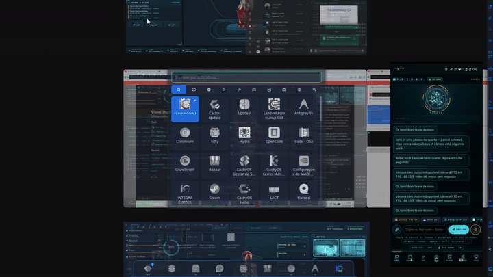

# 📦 Guia de Publicação e Página de Release para o GitHub — Integra Code

Este documento contém o texto pronto para a **Descrição do Repositório GitHub**, **GitHub Release (v2.1.0 Commercial Edition)** e instruções de publicação sob a chancela da **Integra Code**.

---

## 1. Nome e Descrição Curta Sugeridos para o Repositório GitHub
- **Organização / Autor:** `Integra Code`
- **Nome do Repositório:** `friday-autonomous-ai` (ou `prometheus-friday-os`)
- **Descrição Curta (About):**
  > 🤖 F.R.I.D.A.Y. Commercial Edition by Integra Code — Autonomous Multimodal AI Agent for Linux, Windows (.exe) & Android (.apk). Strict Owner-Only Voice Biometrics (TitaNet/WeSpeaker), Native Friday Agenda, Autonomous Dev IDE, Adaptive 0-to-3+ Camera Vision, Local (Ollama/GGUF) or Cloud AI (Gemini/Claude/GPT), P2P Mesh Sync & 100% Zero-Data-Retention Privacy Guarantee.

---

## 2. Texto Completo para a Release Oficial (`v2.1.0 - Integra Code Commercial Release`)

```markdown
# 🚀 F.R.I.D.A.Y. Commercial Edition v2.1.0 — Official Release by Integra Code

A **Integra Code** apresenta o lançamento oficial da edição comercial da **F.R.I.D.A.Y. (Prometheus OS)** — o ecossistema de inteligência artificial autônoma multimodal para **Linux, Windows e Android**, projetado com soberania digital, privacidade absoluta e execução distribuída.



---

### 📥 Instaladores Oficiais Disponíveis nesta Release
* 🪟 **Windows 10 / 11:** [`Instalador_Friday_Comercial_Windows.exe`](Instalador_Friday_Comercial_Windows.exe) (Instalador `.EXE` automático com atalho na Área de Trabalho e inicialização com o Windows)
* 📱 **Android 10+:** [`android/dist/friday-remoto.apk`](android/dist/friday-remoto.apk) (APK nativo com cérebro local GGUF, biometria de voz e floating HUD)
* 🐧 **Linux (Debian / Ubuntu / Fedora / Arch):** `./install_linux.sh && ./run.sh`

---

### 🌟 Principais Recursos e Inovações

#### 1. 🔒 Biometria Vocal Estrita — Apenas a Voz do Dono
* **No PC (Linux / Windows):** Rede neural **NVIDIA TitaNet-L** para verificação de locutor (`voz.py`). O sistema rejeita ativamente vozes de terceiros ou ruídos externos, processando comandos apenas quando o locutor verificado for o dono.
* **No Celular (Android):** Rede neural **WeSpeaker ResNet34 ONNX** integrada diretamente ao APK e ao Assistente Padrão (botão liga/desliga), com limiar dinâmico configurável e aprendizado adaptativo anti-deriva (*Voice Drift Protection*).

#### 2. 📅 Agenda Própria da Friday (Multi-Dispositivo)
* Sistema autônomo de gestão de compromissos que roda nativamente na Friday em vez de depender de calendários de terceiros.
* Níveis de ocupação diária inteligentes (`LIVRE`, `LEVE`, `MODERADO`, `INTENSO`, `CRÍTICO`), cálculo de horas livres em tempo real e timeline com status e prioridades.
* Sincronização automática via malha P2P entre o computador e o aplicativo móvel.

#### 3. 💻 Modo Dev — Engenheira de Software Autônoma
* IDE integrada com loop de execução autônomo em 8 rounds: **Planejamento -> Codificação -> Execução de Testes -> Correção de Bugs**.
* Disponível no PC (integração Claude Code CLI e analisadores locais) e no celular Android (integração Termux ou geração local GGUF).
* Janela flutuante HUD para acompanhamento em tempo real das alterações e diffs de arquivos.

#### 4. ⚡ Tarefas Compostas Determinísticas
* Capacidade de interpretar e encadear ações complexas em comando único, por exemplo:
  * *"Pesquise as principais notícias sobre inteligência artificial e envie no WhatsApp para Fulano"*
  * *"Pesquise sobre computação quântica e crie um arquivo resumo.md na pasta de documentos"*
  * *"Pesquise o clima para o fim de semana e anote na agenda"*

#### 5. 🎨 Interface Holográfica e Fundo de Tela Unificado
* Fundo de tela dinâmico Stark com piso holográfico em perspectiva, reator animado com pulsação de voz e partículas em tempo real.
* Unificado entre **Linux (Wayland PainelStark e plugin Noctalia)** e **Windows (Wallpaper HUD interativo)**.

#### 6. 🌐 Visão Multimodal Adaptativa (0 a 3+ Câmeras)
* Funciona sem nenhuma câmera, com 1 webcam convencional ou com conjunto de câmeras simultâneas (Câmera Nativa, Câmera de Porta, Câmera PTZ com rastreamento ONVIF e câmera traseira/frontal do smartphone).
* Alternância dinâmica entre modelos de visão local (`YOLO-World`, `Moondream`, `Ollama`) e nuvem (`Gemini 2.5 Flash`, `Claude 3.5 Sonnet`, `GPT-4o`).

#### 7. 🛡️ Garantia de Não-Retenção de Dados (Zero-Data-Retention)
* A **Integra Code** garante formalmente que **nenhum dado pessoal, áudio, vídeo ou credencial é transmitido ou retido por nós**.
* Todo o processamento é 100% local ou roteado diretamente da máquina do usuário para o provedor de nuvem de sua escolha ([Termos de Uso](TERMS_OF_USE.md) e [Política de Privacidade](PRIVACY_POLICY.md)).
```

---

## 3. Como Publicar no GitHub

1. Inicialize e faça o push dos arquivos desta pasta para o repositório da Integra Code:
   ```bash
   cd "friday-commercial-github"
   git init
   git add .
   git commit -m "feat: F.R.I.D.A.Y. Commercial Edition v2.1.0 by Integra Code"
   git branch -M main
   git remote add origin https://github.com/integra-code/friday-autonomous-ai.git
   git push -u origin main
   ```
2. Crie a Release oficial anexando os executáveis compilados:
   ```bash
   gh release create v2.1.0 \
     --title "F.R.I.D.A.Y. Commercial Edition v2.1.0 — Integra Code" \
     --notes-file GITHUB_RELEASE_PAGE.md \
     Instalador_Friday_Comercial_Windows.exe \
     android/dist/friday-remoto.apk
   ```
